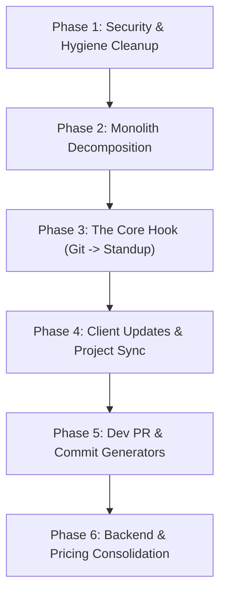

# Magic AI — Step-by-Step Agent Execution Guide

> **Instructions for the Executing Agent:**
> - Work through this guide **one step at a time**.
> - Do not start a new step until the previous step's verification criteria have passed.
> - Ensure all imports, TypeScript types, and styling consistency (Tailwind + shadcn/ui) are preserved.

---

## 🗺️ Execution Roadmap Overview



---

## Phase 1: Security & Dead Code Hygiene

### Step 1.1: Eliminate Hardcoded URLs and Anon Keys
- **Target Files:**
  - `src/services/gitActionsService.ts`
  - `src/pages/VersionControlPage.tsx`
  - `.env` / `.env.example`
- **Problem:**
  - `gitActionsService.ts` currently sends requests to `https://battleship-8p92.onrender.com/vcs/view-commits`.
  - `VersionControlPage.tsx` has a hardcoded Supabase anon JWT string inside `handleOAuthStart`.
- **Instructions:**
  1. Add `VITE_VCS_API_URL` to `.env` and `.env.example` with fallback to the configured backend route.
  2. Replace hardcoded `anonKey` in `VersionControlPage.tsx` with `import.meta.env.VITE_SUPABASE_ANON_KEY`.
  3. Replace the hardcoded render URL in `gitActionsService.ts` with an environment variable or relative API endpoint (`/api/vcs/view-commits`).
- **Verification:**
  - Run `npm run build` or `vite build`. Ensure no compilation errors.
  - Search entire `src/` for any remaining hardcoded `http://` or `https://` third-party staging URLs.

---

### Step 1.2: Remove or Externalize Inline Font Bloat
- **Target Files:**
  - `src/components/openmojiBase64.ts` (~1.9 MB inline file)
  - `src/components/TodaysUpdate.tsx`
- **Problem:**
  - A 1.9 MB inline Base64 font file is loaded directly into the client bundle, ballooning initial load time and memory footprint.
- **Instructions:**
  1. Check if `openmojiBase64.ts` is strictly needed for PDF emoji rendering in `TodaysUpdate.tsx`.
  2. If needed for `jsPDF`: Load it asynchronously via dynamic `fetch()` only when the user clicks "Export PDF", or move the font to `public/fonts/openmoji.ttf`.
  3. Remove `src/components/openmojiBase64.ts` from bundle imports.
- **Verification:**
  - Check bundle size with `vite build`. Bundle size should drop significantly.

---

### Step 1.3: Clean Up Orphan & Unmounted Components
- **Target Files:**
  - `src/components/CorrectLater.tsx`
  - `src/components/GoogleCalendarIntegration.tsx`
- **Instructions:**
  1. Confirm that `CorrectLater.tsx` has zero active routes and stores data solely in unpersisted React state. Delete or archive to `src/components/archived/`.
  2. Verify whether Google Calendar is intended for the current milestone. If not connected to any live navigation or dashboard widget, remove dead calendar imports from `NotificationBell.tsx` and consolidate `notificationService.ts`.
- **Verification:**
  - Check that all remaining files in `src/components/` are actively imported and used.

---

## Phase 2: Monolith Decomposition (`TodaysUpdate.tsx`)

### Step 2.1: Decompose `TodaysUpdate.tsx` (~1,970 Lines)
- **Target File:** `src/components/TodaysUpdate.tsx`
- **New Sub-components to create in `src/components/todays-update/`:**
  - `UpdateInputForm.tsx` (Rough notes text area, project tagger, format options)
  - `FormattedUpdatePreview.tsx` (Formatted output card, style switcher tabs, copy button)
  - `UpdateHistoryList.tsx` (Saved past daily updates, calendar view filter)
  - `SlackExportModal.tsx` (Slack channel/user picker & send dialog)
  - `AnalyticsView.tsx` (Chart.js task/project metrics)
- **Instructions:**
  1. Extract state and handlers into a custom hook: `src/hooks/useDailyUpdates.ts`.
  2. Break down the massive JSX tree into the modular components listed above.
  3. Ensure `TodaysUpdate.tsx` functions as a lean orchestrator (< 200 lines).
- **Verification:**
  - Verify that generating updates, copying text, Slack sending, and history viewing continue to work with zero regressions.

---

## Phase 3: The Core Killer Loop (Git Commits $\rightarrow$ Daily Standup)

### Step 3.1: Fetch User's Daily Git Commits
- **Target Files:**
  - `src/services/versionControlService.ts`
  - Backend/Edge Function `github-data` / `gitlab-data`
- **Instructions:**
  1. Add a service function `fetchTodayCommits(provider: 'github' | 'gitlab')` in `versionControlService.ts`.
  2. The function queries the user's active repositories for commits authored by the authenticated user since midnight (`since = startOfDay.toISOString()`).
  3. Return a sanitized array of commit objects:
     ```ts
     interface DailyCommitSummary {
       repoName: string;
       message: string;
       sha: string;
       timestamp: string;
     }
     ```
- **Verification:**
  - Test calling `fetchTodayCommits()` with a connected GitHub account and verify it returns today's commit list.

---

### Step 3.2: "Auto-Generate from Git" in Standup Formatter
- **Target Files:**
  - `src/components/todays-update/UpdateInputForm.tsx`
  - `src/services/openaiService.ts`
- **Instructions:**
  1. Add a button next to the input textarea: **"⚡ Pull Today's Commits"**.
  2. If GitHub/GitLab is connected:
     - Fetch today's commits.
     - Auto-populate or append the commit messages into the notes field.
  3. Add a dedicated AI action `format_standup_from_commits`:
     - System prompt instructs AI to convert raw commit messages (e.g. `fix: typo in header`, `feat(auth): add jwt refresh`) into clear, professional standup bullet points (Completed Tasks, In Progress, Blockers).
- **Verification:**
  - Click "Pull Today's Commits" $\rightarrow$ Verify text area populates $\rightarrow$ Click "Generate" $\rightarrow$ Verify clean human-readable standup is generated.

---

## Phase 4: Upgrade Client Updates & Project Linking

### Step 4.1: Bind Client Updates to the Projects DB
- **Target Files:**
  - `src/components/ClientUpdate.tsx`
  - `src/services/projectService.ts`
- **Instructions:**
  1. Replace manual text inputs for "Client Name" with a **Project Selector Dropdown** populated from `getProjects()`.
  2. When a project is selected:
     - Auto-fill `clientName` and `clientEmail`.
     - Show the date of `last_update_sent`.
  3. Add a **Tone Selector** dropdown:
     - *Executive Summary (Formal, high-level for enterprise clients)*
     - *Friendly Progress (Casual, for startup clients)*
     - *Milestone Delivery (Focuses on deliverables, links, and next steps)*
  4. On successful generation:
     - Add a "Save Update to Project History" button.
     - Update `projects.last_update_sent` timestamp in the database.
- **Verification:**
  - Create a project in `/projects` $\rightarrow$ Navigate to `/client-update` $\rightarrow$ Select project $\rightarrow$ Generate update $\rightarrow$ Confirm timestamp is updated in DB.

---

## Phase 5: Developer PR & Commit Polish (Repurposing `/correct-sentence`)

### Step 5.1: Pivot Generic Sentence Corrector to "Dev Text Polish"
- **Target Files:**
  - `src/components/CorrectSentence.tsx`
  - `src/App.tsx`
  - `src/components/Sidebar.tsx`
- **Instructions:**
  1. Repurpose this screen from generic grammar correction to **"Dev PR & Docs Assistant"**:
     - Mode 1: **Conventional Commit Generator** (input raw git diff or notes $\rightarrow$ outputs `feat: ...`, `fix: ...`, `refactor: ...`).
     - Mode 2: **PR Description Generator** (inputs summary + changes $\rightarrow$ generates full Markdown PR with Overview, What Changed, Testing Done).
     - Mode 3: **Tech-to-Non-Tech Translator** (explains a complex bug or technical delay in simple terms for non-technical stakeholders).
  2. Update navigation label in `Sidebar.tsx` to **"PR & Commit Assistant"**.
- **Verification:**
  - Open `/correct-sentence` (or renamed route `/dev-tools`) and test generating a PR template and a conventional commit.

---

## Phase 6: Industry Templates & Backend Consolidation

### Step 6.1: Seed Industry Preset Templates
- **Target Files:**
  - `src/pages/StructureTemplatesPage.tsx`
- **Instructions:**
  1. Add a "Starter Presets" gallery that users can load with 1 click:
     - **Agile Daily Standup** (`Yesterday`, `Today`, `Blockers`)
     - **Sprint Retrospective** (`What went well`, `What could improve`, `Action items`)
     - **Client Weekly Digest** (`Key Milestones`, `Current Status`, `Roadmap for Next Week`)
     - **Changelog / Release Notes** (`🚀 Features`, `🐛 Fixes`, `⚡ Improvements`)
  2. Users can customize and save these presets to their `structure_templates` table.
- **Verification:**
  - Visit `/structure-templates` $\rightarrow$ Click "Use Preset: Agile Standup" $\rightarrow$ Verify template is saved and immediately selectable in `/todays-update`.

---

### Step 6.2: Finalize Express API & Sustainable Monetization Check
- **Target Files:**
  - `backend/` (Node.js + Express)
  - `src/contexts/PaidStatusContext.tsx`
- **Instructions:**
  1. Follow `BACKEND_MIGRATION_PLAN.md` to ensure all AI and OAuth routes run through the Node.js Express backend.
  2. Add **BYOK (Bring Your Own Key)** option in user settings (`user_secrets` table):
     - Users can provide their own OpenAI/Anthropic API key.
     - BYOK users bypass all monthly limits without incurring API token costs on your account.
  3. Ensure `UsageGate` accurately accounts for standard users vs. BYOK users.
- **Verification:**
  - Save an API key in user profile $\rightarrow$ Verify AI calls route using the user's custom key $\rightarrow$ Verify feature usage count does not lock them out.
