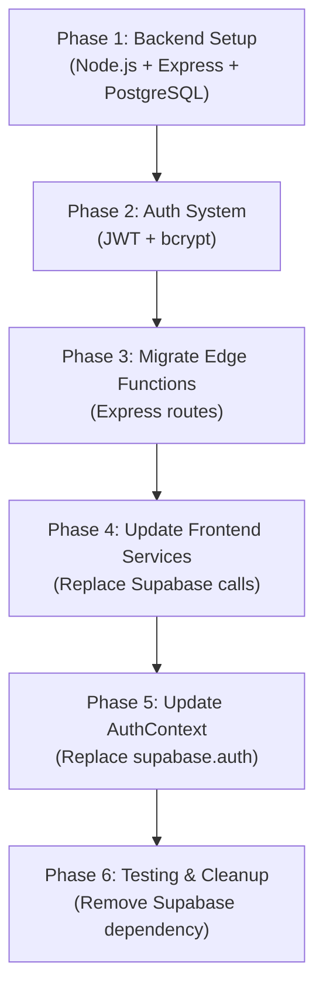

# Backend Migration Plan: Supabase → Node.js + PostgreSQL

> **Goal:** Replace Supabase (Auth + Edge Functions) with a standalone Node.js/Express backend connected directly to PostgreSQL. The React frontend remains unchanged in structure — only the service layer changes.

---

## 📁 Target Backend Structure

```
backend/                          ← New folder alongside frontend root
├── src/
│   ├── server.ts                 # Express app entry point
│   ├── db/
│   │   ├── pool.ts               # pg Pool setup
│   │   └── migrations/           # SQL migration files (copy from supabase/migrations)
│   ├── middleware/
│   │   ├── auth.ts               # JWT verification middleware
│   │   └── errorHandler.ts       # Global error handler
│   ├── routes/
│   │   ├── auth.ts               # POST /register, /login, /logout, /me
│   │   ├── projects.ts           # CRUD /projects
│   │   ├── notifications.ts      # GET/PATCH /notifications
│   │   ├── ai.ts                 # POST /ai (all AI actions)
│   │   ├── github.ts             # GET /github/start, /github/callback, /github/repos
│   │   ├── gitlab.ts             # GET /gitlab/start, /gitlab/callback, /gitlab/projects
│   │   ├── payment.ts            # POST /payment/stripe, /payment/razorpay, /payment/verify
│   │   ├── profile.ts            # GET/PATCH /profile
│   │   ├── usage.ts              # GET /usage, POST /usage/increment
│   │   └── templates.ts          # CRUD /templates
│   └── types/
│       └── index.ts              # Shared types
├── .env                          # Environment variables
├── package.json
└── tsconfig.json
```

---

## 🗺️ Migration Roadmap



---

## Phase 1: Backend Project Setup

### 1.1 Initialize Node.js Backend

```bash
mkdir backend && cd backend
npm init -y
npm install express pg bcryptjs jsonwebtoken cors dotenv helmet express-rate-limit
npm install -D typescript @types/node @types/express @types/pg @types/bcryptjs @types/jsonwebtoken ts-node-dev
```

### 1.2 `tsconfig.json`

```json
{
  "compilerOptions": {
    "target": "ES2020",
    "module": "commonjs",
    "lib": ["ES2020"],
    "outDir": "./dist",
    "rootDir": "./src",
    "strict": true,
    "esModuleInterop": true,
    "resolveJsonModule": true
  }
}
```

### 1.3 `package.json` scripts

```json
{
  "scripts": {
    "dev": "ts-node-dev --respawn --transpile-only src/server.ts",
    "build": "tsc",
    "start": "node dist/server.js"
  }
}
```

### 1.4 Database Connection (`src/db/pool.ts`)

```typescript
import { Pool } from 'pg';
import dotenv from 'dotenv';
dotenv.config();

export const pool = new Pool({
  connectionString: process.env.DATABASE_URL,
  ssl: process.env.NODE_ENV === 'production' ? { rejectUnauthorized: false } : false
});
```

### 1.5 Express App (`src/server.ts`)

```typescript
import express from 'express';
import cors from 'cors';
import helmet from 'helmet';
import dotenv from 'dotenv';
dotenv.config();

import authRouter from './routes/auth';
import projectsRouter from './routes/projects';
import aiRouter from './routes/ai';
import githubRouter from './routes/github';
import gitlabRouter from './routes/gitlab';
import paymentRouter from './routes/payment';
import profileRouter from './routes/profile';
import usageRouter from './routes/usage';
import templatesRouter from './routes/templates';
import notificationsRouter from './routes/notifications';
import { errorHandler } from './middleware/errorHandler';

const app = express();
const PORT = process.env.PORT || 4000;

app.use(helmet());
app.use(cors({ origin: process.env.FRONTEND_URL, credentials: true }));
app.use(express.json());

// Routes
app.use('/api/auth', authRouter);
app.use('/api/projects', projectsRouter);
app.use('/api/ai', aiRouter);
app.use('/api/github', githubRouter);
app.use('/api/gitlab', gitlabRouter);
app.use('/api/payment', paymentRouter);
app.use('/api/profile', profileRouter);
app.use('/api/usage', usageRouter);
app.use('/api/templates', templatesRouter);
app.use('/api/notifications', notificationsRouter);

app.use(errorHandler);

app.listen(PORT, () => console.log(`Backend running on port ${PORT}`));
```

---

## Phase 2: Auth System

### 2.1 Auth Middleware (`src/middleware/auth.ts`)

```typescript
import { Request, Response, NextFunction } from 'express';
import jwt from 'jsonwebtoken';

export interface AuthRequest extends Request {
  userId?: string;
}

export const authenticate = (req: AuthRequest, res: Response, next: NextFunction) => {
  const token = req.headers.authorization?.replace('Bearer ', '');
  if (!token) return res.status(401).json({ error: 'No token provided' });

  try {
    const decoded = jwt.verify(token, process.env.JWT_SECRET!) as { userId: string };
    req.userId = decoded.userId;
    next();
  } catch {
    return res.status(401).json({ error: 'Invalid or expired token' });
  }
};
```

### 2.2 Auth Routes (`src/routes/auth.ts`)

```typescript
// POST /api/auth/register
// POST /api/auth/login
// GET  /api/auth/me
// POST /api/auth/logout
```

**Register logic:**
1. Hash password with `bcrypt.hash(password, 12)`
2. Insert into `users` table (new table replacing `auth.users`)
3. Insert into `profiles` table
4. Return JWT

**Login logic:**
1. Find user by email
2. `bcrypt.compare(password, hash)`
3. Return JWT with `{ userId, email }` payload

> [!IMPORTANT]
> The `auth.users` table is Supabase-specific. For the Node.js backend, create a new `users` table in the same PostgreSQL database:
> ```sql
> CREATE TABLE public.users (
>   id UUID PRIMARY KEY DEFAULT gen_random_uuid(),
>   email TEXT UNIQUE NOT NULL,
>   password_hash TEXT NOT NULL,
>   full_name TEXT,
>   username TEXT UNIQUE,
>   created_at TIMESTAMPTZ DEFAULT now(),
>   updated_at TIMESTAMPTZ DEFAULT now()
> );
> ```

---

## Phase 3: Migrate Supabase Edge Functions → Express Routes

### 3.1 AI Endpoint (`POST /api/ai`)

**Replaces:** `supabase/functions/get-openai-key`

```typescript
// src/routes/ai.ts
router.post('/', authenticate, async (req, res) => {
  const { action, isRefresh, sentence, keywords, ... } = req.body;
  // Same logic as the Deno function, but in Node.js
  // Call OpenAI API with process.env.OPENAI_API_KEY
  // Track usage via pool.query('SELECT increment_feature_usage($1, $2)', [userId, action])
});
```

### 3.2 GitHub OAuth (`src/routes/github.ts`)

**Replaces:** `supabase/functions/github-oauth`

```typescript
// GET /api/github/start → returns GitHub OAuth URL
// GET /api/github/callback → exchanges code, saves token, redirects to frontend
// GET /api/github/repos → fetches repos using stored token
// GET /api/github/repo/:id → fetches single repo details
// POST /api/github/disconnect → deletes token from DB
```

**Callback flow:**
1. Receive `code` + `state` (JWT) from GitHub
2. Decode JWT to get `userId`
3. Exchange `code` for `access_token` via GitHub API
4. Save to `user_github_tokens` table
5. Redirect to `FRONTEND_URL/version-control?provider=github&status=success`

### 3.3 GitLab OAuth (`src/routes/gitlab.ts`)

Same pattern as GitHub.

### 3.4 Payment Routes (`src/routes/payment.ts`)

**Replaces:** `create-razorpay-order`, `create-stripe-checkout`, `verify-razorpay-payment`, `stripe-webhook-unlock`

```typescript
// POST /api/payment/stripe/create-checkout → create Stripe session
// POST /api/payment/stripe/webhook → Stripe webhook handler (raw body!)
// POST /api/payment/razorpay/create-order → create Razorpay order
// POST /api/payment/razorpay/verify → verify signature, mark paid
```

> [!CAUTION]
> Stripe webhooks require raw body (not parsed JSON). Use `express.raw({ type: 'application/json' })` on the webhook route before `express.json()` middleware.

### 3.5 Usage Routes (`src/routes/usage.ts`)

```typescript
// GET  /api/usage → returns { totalUsage, isPaidUser, resetDate }
// POST /api/usage/increment → { featureName } → calls increment_feature_usage()
```

### 3.6 Profile Routes (`src/routes/profile.ts`)

```typescript
// GET  /api/profile → returns profile for authenticated user
// PATCH /api/profile → update full_name, username, avatar_url
```

### 3.7 Projects Routes (`src/routes/projects.ts`)

```typescript
// GET    /api/projects → list user's projects
// POST   /api/projects → create project
// PATCH  /api/projects/:id → update project
// DELETE /api/projects/:id → delete project
```

### 3.8 Notifications Routes (`src/routes/notifications.ts`)

```typescript
// GET   /api/notifications → list undismissed notifications
// PATCH /api/notifications/:id/read → mark as read
// PATCH /api/notifications/:id/dismiss → mark dismissed
```

### 3.9 Structure Templates (`src/routes/templates.ts`)

```typescript
// GET    /api/templates → list user's templates
// POST   /api/templates → create template
// PATCH  /api/templates/:id → update template
// DELETE /api/templates/:id → delete template
```

---

## Phase 4: Update Frontend Services

### 4.1 Create API Client (`src/lib/apiClient.ts`)

```typescript
const BASE_URL = import.meta.env.VITE_API_BASE_URL; // http://localhost:4000/api

const getToken = () => localStorage.getItem('auth_token');

export const apiClient = {
  get: (path: string) =>
    fetch(`${BASE_URL}${path}`, {
      headers: { Authorization: `Bearer ${getToken()}` }
    }).then(r => r.json()),

  post: (path: string, body: any) =>
    fetch(`${BASE_URL}${path}`, {
      method: 'POST',
      headers: { 'Content-Type': 'application/json', Authorization: `Bearer ${getToken()}` },
      body: JSON.stringify(body)
    }).then(r => r.json()),

  patch: (path: string, body: any) =>
    fetch(`${BASE_URL}${path}`, {
      method: 'PATCH',
      headers: { 'Content-Type': 'application/json', Authorization: `Bearer ${getToken()}` },
      body: JSON.stringify(body)
    }).then(r => r.json()),

  delete: (path: string) =>
    fetch(`${BASE_URL}${path}`, {
      method: 'DELETE',
      headers: { Authorization: `Bearer ${getToken()}` }
    }).then(r => r.json()),
};
```

### 4.2 Service Files to Update

| File | Change Required |
|---|---|
| `src/services/openaiService.ts` | Replace `fetch(supabaseUrl/functions/v1/get-openai-key, ...)` with `apiClient.post('/ai', {...})` |
| `src/services/projectService.ts` | Replace `supabase.from('projects')` with `apiClient.get/post/patch/delete('/projects')` |
| `src/services/notificationService.ts` | Replace `supabase.from('notifications')` with `apiClient.get/patch('/notifications')` |
| `src/services/versionControlService.ts` | Replace `supabase.functions.invoke('github-data')` with `apiClient.get('/github/repos')` |
| `src/hooks/useUsageTracking.ts` | Replace `supabase.rpc(...)` with `apiClient.post('/usage/increment', ...)` |

### 4.3 Usage Tracking Hook Changes

**Before:**
```typescript
const { data } = await supabase.rpc('get_total_usage', { p_user_id: user.id });
```

**After:**
```typescript
const data = await apiClient.get('/usage');
setTotalUsage(data.totalUsage);
setIsPaidUser(data.isPaidUser);
```

---

## Phase 5: Update AuthContext

### 5.1 New AuthContext (`src/contexts/AuthContext.tsx`)

**Before (Supabase):**
```typescript
const { data: { subscription } } = supabase.auth.onAuthStateChange(...)
supabase.auth.signInWithPassword({ email, password })
supabase.auth.signUp({ email, password, options: { data: {...} } })
supabase.auth.signOut()
```

**After (Node.js):**
```typescript
// On app load: check for token in localStorage, call GET /api/auth/me
// signIn: POST /api/auth/login → receive { token, user } → store token
// signUp: POST /api/auth/register → receive { token, user } → store token
// signOut: DELETE token from localStorage, optionally call POST /api/auth/logout
```

### 5.2 User Type Change

Supabase provides a `User` type from `@supabase/supabase-js`. After migration, define a custom User type:

```typescript
export interface User {
  id: string;
  email: string;
  fullName?: string;
  username?: string;
  avatarUrl?: string;
}
```

Remove the `@supabase/supabase-js` dependency from `package.json` after full migration.

---

## Phase 6: Database Migration

### 6.1 Setup PostgreSQL locally or on a server

```bash
# Local dev
docker run --name magic-ai-db -e POSTGRES_PASSWORD=password -e POSTGRES_DB=magic_ai -p 5432:5432 -d postgres:16
```

### 6.2 Run existing migrations

The existing `supabase/migrations/*.sql` files contain the schema. But they reference `auth.users` (Supabase-specific). You need to:

1. Create a new `users` table (as shown in Phase 2)
2. Change all `REFERENCES auth.users(id)` to `REFERENCES public.users(id)`
3. Remove `auth.uid()` from RLS policies (not needed; Node.js handles auth)
4. Remove all `ALTER TABLE ... ENABLE ROW LEVEL SECURITY` (handled at app level now)

### 6.3 Combined init SQL

```sql
-- Run this to bootstrap the Node.js-compatible database:
CREATE TABLE public.users (
  id UUID PRIMARY KEY DEFAULT gen_random_uuid(),
  email TEXT UNIQUE NOT NULL,
  password_hash TEXT NOT NULL,
  full_name TEXT,
  username TEXT UNIQUE,
  created_at TIMESTAMPTZ DEFAULT now(),
  updated_at TIMESTAMPTZ DEFAULT now()
);

CREATE TABLE public.profiles (
  id UUID PRIMARY KEY REFERENCES public.users(id) ON DELETE CASCADE,
  paid_user BOOLEAN DEFAULT false,
  avatar_url TEXT,
  created_at TIMESTAMPTZ DEFAULT now(),
  updated_at TIMESTAMPTZ DEFAULT now()
);

-- ... (all other tables with auth.users → public.users)
```

---

## 🧪 Testing Strategy

| Test Type | Tool |
|---|---|
| Unit tests (routes) | Jest + Supertest |
| Integration tests | Jest + test PostgreSQL DB |
| E2E (frontend) | Playwright |

---

## 🚀 Deployment

| Service | Host Options |
|---|---|
| Node.js Backend | Railway, Render, Fly.io, EC2, DigitalOcean |
| PostgreSQL | Railway (managed), Supabase (DB-only mode), Neon, RDS |
| Frontend | Netlify (unchanged) |

**Environment variables to set in production:**
```
DATABASE_URL=postgresql://...
JWT_SECRET=<random-256-bit-key>
OPENAI_API_KEY=sk-...
GITHUB_CLIENT_ID=...
GITHUB_CLIENT_SECRET=...
GITLAB_CLIENT_ID=...
GITLAB_CLIENT_SECRET=...
RAZORPAY_KEY_ID=...
RAZORPAY_KEY_SECRET=...
STRIPE_SECRET_KEY=...
STRIPE_WEBHOOK_SECRET=...
FRONTEND_URL=https://magicaidevops.netlify.app
PORT=4000
NODE_ENV=production
```

---

## ✅ Migration Checklist

### Backend
- [ ] Initialize `backend/` folder with Node.js + TypeScript
- [ ] Set up PostgreSQL pool connection
- [ ] Create `users` table (replaces `auth.users`)
- [ ] Run schema migrations (update FK references)
- [ ] Implement JWT auth middleware
- [ ] `POST /api/auth/register`
- [ ] `POST /api/auth/login`
- [ ] `GET /api/auth/me`
- [ ] `POST /api/ai` (all AI actions)
- [ ] `GET /api/github/start` + `GET /api/github/callback`
- [ ] `GET /api/github/repos` + `GET /api/github/repo/:id`
- [ ] `POST /api/github/disconnect`
- [ ] `GET /api/gitlab/start` + `GET /api/gitlab/callback`
- [ ] `GET /api/gitlab/projects` + `GET /api/gitlab/project/:id`
- [ ] `POST /api/payment/stripe/create-checkout`
- [ ] `POST /api/payment/stripe/webhook`
- [ ] `POST /api/payment/razorpay/create-order`
- [ ] `POST /api/payment/razorpay/verify`
- [ ] `GET /api/projects` + `POST` + `PATCH /:id` + `DELETE /:id`
- [ ] `GET /api/notifications` + `PATCH /:id/read` + `PATCH /:id/dismiss`
- [ ] `GET /api/usage` + `POST /api/usage/increment`
- [ ] `GET/POST/PATCH/DELETE /api/templates`
- [ ] `GET/PATCH /api/profile`

### Frontend
- [ ] Add `VITE_API_BASE_URL` to `.env`
- [ ] Create `src/lib/apiClient.ts`
- [ ] Update `AuthContext.tsx` (remove Supabase auth)
- [ ] Update `openaiService.ts`
- [ ] Update `projectService.ts`
- [ ] Update `notificationService.ts`
- [ ] Update `versionControlService.ts`
- [ ] Update `useUsageTracking.ts`
- [ ] Update `calendarEventsService.ts`
- [ ] Update `PaymentPage.tsx` (payment function calls)
- [ ] Remove `@supabase/supabase-js` from `package.json`
- [ ] Remove `src/integrations/supabase/` folder

### Cleanup
- [ ] Remove `supabase/` folder
- [ ] Update `README.md`
- [ ] Update CI/CD env vars
